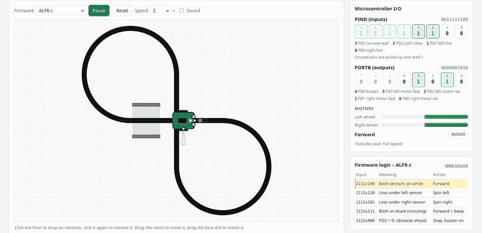
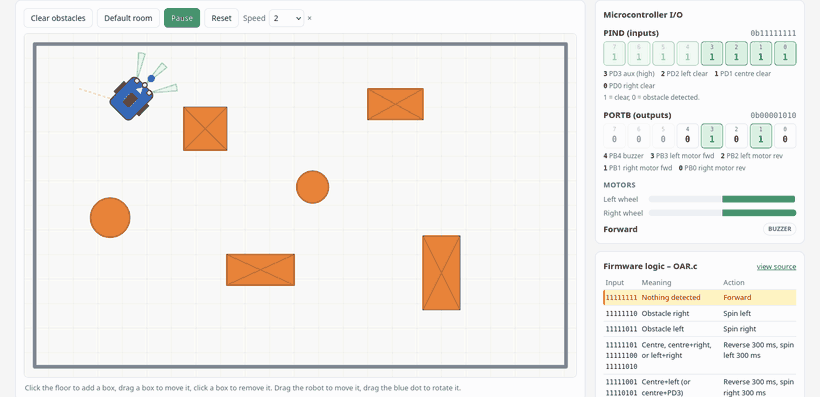
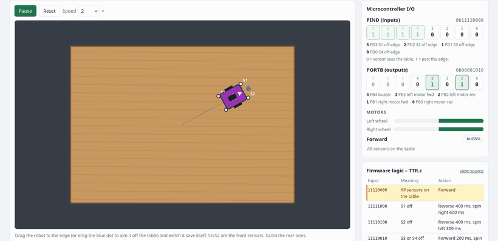
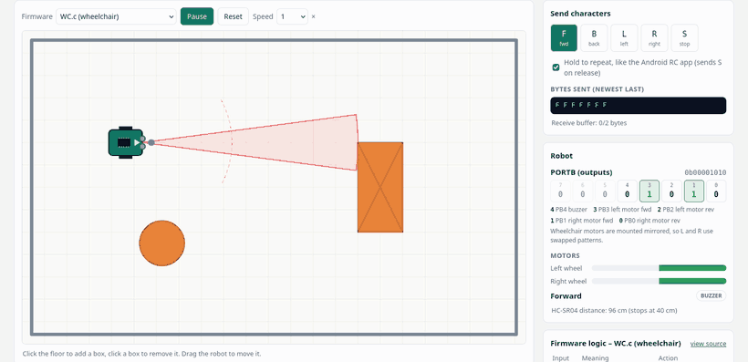
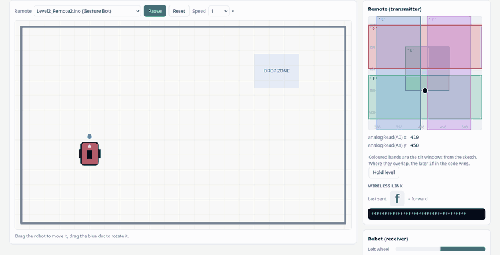
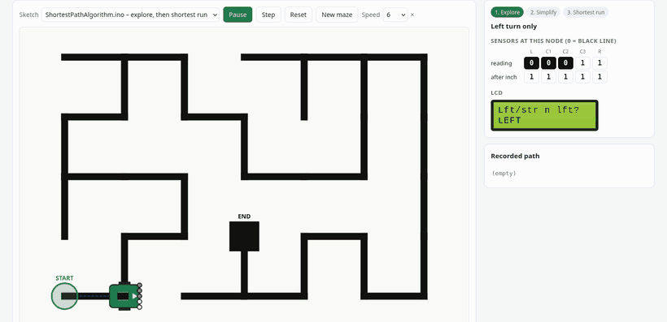
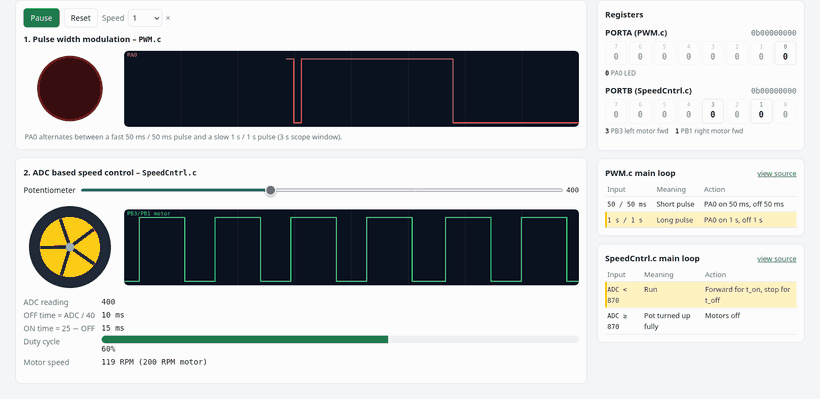
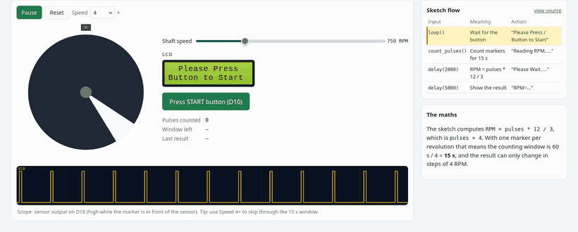

<div align="center">

# 🤖 Kaizen Robotics Program

**Robotics and embedded-systems projects from the Kaizen Robotics Program at IIT Madras Research Park, Chennai.**
Every robot in this repository can be watched running live in your browser.


-1f7a4d)




<sub>The competition line follower (<code>ALFR.c</code>) in the live demo. The panels on the right show the input pins, the motor outputs and the firmware case that is running.</sub>

</div>

---

## Contents
- [The Program](#the-program)
- [Live Demos](#live-demos)
- [Projects](#projects)
- [Repository Layout](#repository-layout)
- [Getting Started](#getting-started)
- [How the Code Is Written](#how-the-code-is-written)

---

## The Program
The Kaizen Robotics Program is a certificate course that gives students a fast, hands-on start in robotics and
embedded systems: **40 hours** of intensive training at IIT Madras Research Park, Chennai, India.

| | Platform | Focus |
|---|---|---|
| **[Level 1](https://www.eventshigh.com/detail/chennai/5d49814f9d1a70b862053ed0d8182bcc-kaizen-robotics-program-level-1)** | ATmega16, Embedded C (WinAVR) | Register-level programming: GPIO, ADC, PWM, UART, timers |
| **[Level 2](https://www.eventshigh.com/detail/chennai/35c36b3a32cf6d100297c4521d9a6f50-kaizen-robotics-program-level-2)** | ATmega16, Arduino | Wireless and gesture control, robot arms, LCDs, maze solving |

---

## Live Demos
**[Open the live demos](https://sundarrajnitish.github.io/Kaizen-Robotics-Program/demos/)**, or open [`demos/index.html`](demos/index.html) from a local copy. They need no installation or server and work offline.

The single-page workbench includes all 15 experiments, search, level filters, light/dark themes, and an optional guide. Select an experiment to run it in place; switching experiments resets its simulation. The design follows the workbench style of the FARM-E and RTMC-HG labs.

Each demo runs a JavaScript port of the robot's real firmware, one case for every branch of the C / Arduino code,
inside a small physics simulation. You can drag the robot, drop obstacles, tilt a virtual accelerometer or turn a
potentiometer and see how the firmware reacts.

<table>
<tr>
<td width="50%" valign="top">

### Obstacle Avoider


Three IR proximity sensors and a timed escape manoeuvre for each obstacle pattern.<br>
▶ [`obstacle-avoider.html`](demos/obstacle-avoider.html) · 📄 [`OAR.c`](Level%201/Obstacle%20Avoider%20Robot/OAR.c)

</td>
<td width="50%" valign="top">

### Table Top Robot


Four edge sensors keep it from driving off the table.<br>
▶ [`table-top.html`](demos/table-top.html) · 📄 [`TTR.c`](Level%201/Table%20Top%20Robot/TTR.c)

</td>
</tr>
<tr>
<td width="50%" valign="top">

### Bluetooth Wheelchair (final project)


Driven from a phone over an HC-05 module. It stops and backs away when the ultrasonic sensor sees something within 40 cm.<br>
▶ [`serial-control.html`](demos/serial-control.html?fw=WC) · 📄 [`WC.c`](Level%201/Final%20Project/Bluetooth-Controlled-WheelChair-with-Obstacle-Avoidance-master/WC.c)

</td>
<td width="50%" valign="top">

### Gesture Controlled Robot


The remote turns accelerometer tilt into one-letter commands and the robot drives on each letter it receives.<br>
▶ [`gesture.html`](demos/gesture.html) · 📄 [`Level2_Remote2.ino`](Level%202/Gesture%20Bot/Level2_Remote2/Level2_Remote2.ino)

</td>
</tr>
<tr>
<td width="50%" valign="top">

### Maze Solver + Shortest Path


Explores the maze with the left hand rule, removes every dead-end detour from its path, then drives the shortest route.<br>
▶ [`maze.html`](demos/maze.html) · 📄 [`ShortestPathAlgorithm.ino`](Level%202/Shortest%20Path%20Algorithm/ShortestPathAlgorithm.ino)

</td>
<td width="50%" valign="top">

### PWM & ADC Speed Control


Software PWM on a pin, then motor speed set by a potentiometer through the ADC.<br>
▶ [`pwm-adc.html`](demos/pwm-adc.html) · 📄 [`PWM.c`](Level%201/PWM/PWM.c), [`SpeedCntrl.c`](Level%201/ADC%20Based%20Speed%20Control/SpeedCntrl.c)

</td>
</tr>
<tr>
<td width="50%" valign="top">

### Tachometer


Counts IR pulses from a spinning shaft for 15 s and shows the RPM on a 16x2 LCD.<br>
▶ [`tachometer.html`](demos/tachometer.html) · 📄 [`Tachometer_Assignment.ino`](Level%202/Assignments/Tachometer_Assignment/Tachometer_Assignment.ino)

</td>
<td width="50%" valign="top">

### More in the demos
- **Line followers:** basic, obstacle-aware and competition versions
- **Serial control:** PC terminal (`TTL.c`), two-speed WASD and a keyboard-driven robot arm
- **Pick & place:** steer by tilt, then lift, grip and carry a block to the drop zone
- **Maze return:** reverse and mirror the path to drive back to the start

</td>
</tr>
</table>

> **Run them online:** **https://sundarrajnitish.github.io/Kaizen-Robotics-Program/demos/** (GitHub Pages).
> The `▶` links above open the page source on GitHub; to run a demo offline, download the repository and open the file in a browser.

---

## Projects

### Level 1 · ATmega16, register-level Embedded C

| Project | What it does | Source | Demo |
|---|---|---|---|
| Pulse Width Modulation | Toggles a pin with different pulse widths | [`PWM.c`](Level%201/PWM/PWM.c) | [▶](demos/pwm-adc.html) |
| ADC Based Speed Control | Potentiometer → ADC → software PWM motor speed | [`SpeedCntrl.c`](Level%201/ADC%20Based%20Speed%20Control/SpeedCntrl.c) | [▶](demos/pwm-adc.html) |
| Line Following Robot | Two IR sensors straddle the line; beeps at crossings | [`LFR.c`](Level%201/Line%20Follower%20Robot/LFR.c) | [▶](demos/line-follower.html?fw=LFR) |
| Obstacle Avoiding Robot | Three proximity sensors, timed escape manoeuvres | [`OAR.c`](Level%201/Obstacle%20Avoider%20Robot/OAR.c) | [▶](demos/obstacle-avoider.html) |
| Obstacle Avoiding Line Follower | Follows the line and waits while the path is blocked | [`OARLFR.c`](Level%201/OAR%20+%20LFR/OARLFR.c) | [▶](demos/line-follower.html?fw=OARLFR) |
| Table Top Robot | Edge detection with four downward IR sensors | [`TTR.c`](Level%201/Table%20Top%20Robot/TTR.c) | [▶](demos/table-top.html) |
| Serial Communication | Drive from a PC terminal through a USB-TTL dongle | [`TTL.c`](Level%201/TTL%20Dongle%20(Communication)/TTL.c) | [▶](demos/serial-control.html?fw=TTL) |
| Advanced Line Follower *(competition)* | Junctions, obstacle alarm, slow PWM speed in caves | [`ALFR.c`](Level%201/Line%20Follower%20Competition/Advanced-Line-Following-Robot-master/ALFR.c) · [`.ino`](Level%201/Line%20Follower%20Competition/Advanced-Line-Following-Robot-master/ALFR(Arduino).ino) | [▶](demos/line-follower.html?fw=ALFR) |
| Bluetooth Wheelchair *(final project)* | HC-05 control with HC-SR04 obstacle stop | [`WC.c`](Level%201/Final%20Project/Bluetooth-Controlled-WheelChair-with-Obstacle-Avoidance-master/WC.c) | [▶](demos/serial-control.html?fw=WC) |
| Simple Handwriting Robot | Arduino drawing machine | [separate repo](https://github.com/NithishSundarraj/Handwriting-Machine/) | – |

### Level 2 · ATmega16, Arduino

| Project | What it does | Source | Demo |
|---|---|---|---|
| RF / Gesture Remote | Accelerometer tilt → one-letter commands | [`Level2_Remote.ino`](Level%202/RF%20Control/Level2_Remote.ino) · [`Level2_Remote2.ino`](Level%202/Gesture%20Bot/Level2_Remote2/Level2_Remote2.ino) | [▶](demos/gesture.html) |
| Gesture Pick & Place Robot | Receiver driving the chassis and a two-motor arm | [`Assignment_Gesture2.ino`](Level%202/Assignments/Assignment_Gesture2/Assignment_Gesture2.ino) · [`Assignment_Arm_Remote.ino`](Level%202/Assignments/Assignment_Arm_Remote/Assignment_Arm_Remote.ino) | [▶](demos/gesture.html?fw=ArmRemote) |
| Wireless DPDT Remote | Switch-based wireless joystick | [`Assignment_DPDT_Wireless.ino`](Level%202/Assignments/Assignment_DPDT_Wireless/Assignment_DPDT_Wireless.ino) | [▶](demos/gesture.html?fw=DPDTRemote) |
| Computer Controlled Robot | Keyboard control of chassis and arm, LCD feedback | [`Computer_Controlled.ino`](Level%202/Computer_Controlled/Computer_Controlled.ino) | [▶](demos/serial-control.html?fw=ComputerControlled) |
| Two-Speed Serial Control | WASD driving; Shift for full speed | [`Speed_Control_Assignment.ino`](Level%202/Assignments/Speed_Control_Assignment/Speed_Control_Assignment.ino) | [▶](demos/serial-control.html?fw=SpeedControl) |
| Potentiometer Speed Control | Drives forward; speed set in hardware | [`Assignment_Potentiometer.ino`](Level%202/Assignments/Assignment_Potentiometer/Assignment_Potentiometer.ino) | – |
| Tachometer | Shaft RPM from IR pulses on an LCD | [`Tachometer_Assignment.ino`](Level%202/Assignments/Tachometer_Assignment/Tachometer_Assignment.ino) | [▶](demos/tachometer.html) |
| Maze Solving Robot | Left hand rule exploration with 5 line sensors | [`maze_solver.ino`](Level%202/Maze_Solver/maze_solver.ino) | [▶](demos/maze.html?mode=explore) |
| Maze Solver with Shortest Path | Removes dead-end detours, then runs the optimal route | [`ShortestPathAlgorithm.ino`](Level%202/Shortest%20Path%20Algorithm/ShortestPathAlgorithm.ino) · [repo](https://github.com/NithishSundarraj/Maze-Solving-Robot-with-Shortest-Path-Algorithm) | [▶](demos/maze.html?mode=replay) |
| Maze Return | Reverses and mirrors the path to drive back to the start | [`Maze_bot_return_final.ino`](Level%202/Assignments/Maze%20Return%20Assignment/Maze_bot_return_final.ino) | [▶](demos/maze.html?mode=return) |

<details>
<summary><b>ATmega16 pinout</b></summary>
<br>

</details>

---

## Repository Layout
```
Kaizen-Robotics-Program/
├── Level 1/              Embedded C projects (one folder each: source, Makefile, .hex)
├── Level 2/              Arduino sketches (.ino), assignments in Level 2/Assignments
├── demos/                Live browser demos
│   ├── index.html        Demo gallery - start here
│   ├── assets/           Simulator (kaizen.js), firmware ports (firmware.js),
│   │                     robot wiring (rigs.js), maze model (maze.js), styles
│   └── tests/            Headless checks: node demos/tests/run-tests.js
├── docs/media/           Animated previews used in this README
├── Softwares/            Course software (multi-part .rar archive)
└── Atmega 16_pins.PNG    ATmega16 pinout reference
```

---

## Getting Started

**Run the demos**: online at https://sundarrajnitish.github.io/Kaizen-Robotics-Program/demos/, or locally:
```bash
git clone https://github.com/sundarrajnitish/Kaizen-Robotics-Program.git
# then open Kaizen-Robotics-Program/demos/index.html in a browser
```

**Build Level 1 (Embedded C)**: use WinAVR or `avr-gcc` with `avr-libc`. The target is the ATmega16 at 1 MHz.
```bash
cd "Level 1/Line Follower Robot"
make all          # produces LFR.hex, ready to flash
```

**Build Level 2 (Arduino)**: open the `.ino` in the Arduino IDE with an ATmega16 board core installed (for example
MightyCore). The LCD sketches use the built-in `LiquidCrystal` library.

**Test the simulations** (needs Node.js)
```bash
node demos/tests/run-tests.js
```
These checks confirm that every firmware port still behaves like its robot. For example: the line followers stay on the line,
the table-top robot never falls off, and the maze runs are optimal on 200 random mazes.

---

## How the Code Is Written
Every source file follows the same layout:

- **Header comment:** project, level, board, what the robot does and how it is wired.
- **Named constants instead of magic numbers:** motor patterns (`MOTOR_FORWARD = 0b00001010`), sensor patterns, timings and pins.
- **One decision per `switch` / `if` chain**, with one comment per case.
- **Style:** 4-space indentation, braces on their own line, `snake_case` function names.

```c
switch (PIND)
{
    case LINE_CENTRED:
        PORTB = MOTOR_FORWARD;
        break;

    case LINE_UNDER_LEFT:
        PORTB = MOTOR_LEFT;
        break;

    case CROSSROAD:
        PORTB = MOTOR_FORWARD | BUZZER;     // Beep and cross over
        _delay_ms(200);
        break;
}
```

<div align="center"><sub>Kaizen Robotics Program · IIT Madras Research Park, Chennai</sub></div>

### Updating the lab

The individual demo HTML files remain the simulation sources. After editing one or `demos/experiments.json`, run `python3 tools/build-demos.py` to refresh the offline document bundle. The workbench mounts only the active simulation, so switching releases the previous animation and controls. Run `node demos/tests/run-tests.js` to check firmware behavior.
